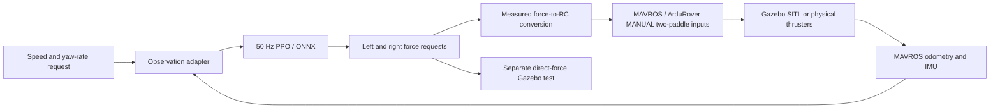

# BlueBoat PPO deployment

A learned controller that tracks **surge speed (m/s) and yaw rate (rad/s)** at 50 Hz. PPO was trained in MJX; the same deterministic policy has been transferred to Gazebo using independent left/right thruster forces. It does not plan waypoints.

**Status:** standalone ONNX inference and direct-force Gazebo reproduction tested on macOS. The ROS 2 / MAVROS integration is implemented, defaults to shadow mode, and still needs execution in Alberto's environment. Physical BlueBoat deployment is **not validated**. No measured motor calibration is supplied, so actuator mode refuses to start with the shipped template.



| Component | Location |
|---|---|
| **ROS 2 package Alberto installs** | [`ros2_ws/src/blueboat_ppo_controller/`](ros2_ws/src/blueboat_ppo_controller/) |
| Installation and operating guide | [`docs/ALBERTO_SETUP.md`](docs/ALBERTO_SETUP.md) |
| Unchanged original checkpoint | [`policy/checkpoints/blueboat_coupled_4m_mac.model`](policy/checkpoints/blueboat_coupled_4m_mac.model) |
| Verified ONNX model and observation contract | [`policy/inference/`](policy/inference/) (links to the package's bundled assets) |
| Observation/network specification | [`docs/ARCHITECTURE.md`](docs/ARCHITECTURE.md) |
| Topics and services | [`docs/ROS_INTERFACES.md`](docs/ROS_INTERFACES.md) |
| Calibration and real-boat gates | [`docs/REAL_BOAT_SAFETY.md`](docs/REAL_BOAT_SAFETY.md) |
| IMU effective-thrust calibration, plots and guarded inverse | [`docs/THRUST_CALIBRATION.md`](docs/THRUST_CALIBRATION.md) |
| Reproduction and validation | [`docs/SIMULATION_VALIDATION.md`](docs/SIMULATION_VALIDATION.md) |
| Attribution and license findings | [`docs/PROVENANCE.md`](docs/PROVENANCE.md) |

## Alberto’s physical boat configuration

The [boat-specific guide](docs/ALBERTO_BOAT.md) provides the prefilled November 9 parameter profile, corrected servo mapping, configurable 23 kg mass and short field commands. Run `./scripts/install_alberto.sh` on the Humble machine, then `./scripts/alberto.sh status`. QGroundControl and network MAVProxy routing are confirmed. An [exclusive gateway](docs/GCS_HANDOFF.md) now handles manual/PPO/calibration ownership and independent ground grants. The supplied settings are preserved; powered modes remain blocked by unverified routing, parameter conflicts, measurements and on-boat acceptance. Telemetry/dry-run/shadow are available.

## Quick start: inference and ROS 2 shadow mode

On Ubuntu 22.04 with ROS 2 Humble, MAVROS, colcon and their dependencies already installed:

```bash
git clone --branch main https://github.com/EdwinMeriaux/gazebo_blue_boat.git
cd gazebo_blue_boat
source /opt/ros/humble/setup.bash
/usr/bin/python3 -m venv --system-site-packages .venv
source .venv/bin/activate
python -m pip install -r requirements.txt
python -m pip install ./ros2_ws/src/blueboat_ppo_controller
inference_test
cd ros2_ws
python -m colcon build --symlink-install --packages-select blueboat_ppo_controller
source install/setup.bash
ros2 launch blueboat_ppo_controller controller.launch.py
```

The node waits for valid telemetry, estimator status and fresh commands. It creates **no RC override publisher in shadow mode**. Follow [Alberto's guide](docs/ALBERTO_SETUP.md) for an existing workspace, MAVROS configuration, command publishing and SITL acceptance. No velocity-setpoint topic is used to drive the boat.

## Reproducing simulations

The standalone deployment needs NumPy, SciPy and ONNX Runtime CPU; no JAX, Flax, MuJoCo or research checkout. Optional simulation tools have separate dependencies and instructions:

- [`simulation/gazebo/README.md`](simulation/gazebo/README.md): original PPO → Newton-valued force → marine physics, plus instructions for the separate SITL path.
- [`simulation/mjx/README.md`](simulation/mjx/README.md): corrected planar MJX reproduction.

Historical six-episode calm-water mean RMSE: MJX **0.0670 m/s, 0.0617 rad/s**; Gazebo **0.0695 m/s, 0.0652 rad/s**. The older policy's Gazebo yaw RMSE was **0.1825 rad/s**. These are simulation-to-simulation results after physics calibration, not real-water evidence.

Developer checks:

```bash
python -m pip install -r requirements-dev.txt
python -m pytest -q
```

## Simple relative-distance field scripts

The `alberto/simple-field-scripts` branch adds three standalone launchers for an explicitly unchecked PWM pulse sequence, a 20 m outward / 18 m return route, and a 25 m approach followed by a 12 m-diameter circle and return to 2 m ahead of the start. The routes are relative to the starting local-odometry pose rather than GPS latitude/longitude waypoints. See [`docs/SIMPLE_FIELD_RUNS.md`](docs/SIMPLE_FIELD_RUNS.md).

Tests explicitly skip real ROS message serialization when ROS 2 is unavailable. Transport-mocked node tests are separately identified. See the validation report for what actually ran.

The separate `thrust_calibration` executable defaults to **dry-run** and has no motor publisher in dry-run/telemetry modes. It records IMU/attitude/velocity/PWM, requires a sustained rest baseline before guarded single/symmetric motor pulses, and fits draft forward/reverse **effective surge-force** tables using the recorded total-mass parameter. Analysis produces a guarded PPO calibration draft; the original PPO outputs remain in Newtons. Follow [Alberto's calibration guide](docs/THRUST_CALIBRATION.md) for synthetic tests, live SITL acceptance, physical assumptions and optional PPO integration. These estimates are not static propeller thrust, and independent motor forces are not automatically identified.
